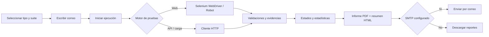

# TQA Center  — Automatización y aseguramiento de la calidad

**Proyecto integrador de Testing y Aseguramiento de la Calidad (TQA)**  
**UNIFRANZ · La Paz, Bolivia · Gestión 2026**

TQA Center es una aplicación web que desarrollé para **seleccionar, ejecutar, observar y documentar pruebas de software desde una sola interfaz**. Permite iniciar pruebas funcionales y no funcionales, visualizar el avance de cada caso y obtener un **informe detallado en PDF** y un **resumen en HTML**. Cuando se configura un servidor SMTP, ambos reportes se envían al correo indicado por el usuario.

La versión **8.6** mantiene la interfaz de tres paneles del proyecto original: selección de pruebas, monitor de ejecución y resultados. Está preparada para probar el sistema minero **CIARÁ** en un entorno local autorizado, además de incluir un sistema de demostración propio.

> **Alcance de las evidencias:** una prueba se marca `PASS` o `FAIL` según la ejecución de su motor de pruebas. Las pruebas técnicas de este repositorio no sustituyen la demostración en vivo contra una instancia real de CIARÁ.

## 1. Objetivo del proyecto

Mi objetivo es facilitar el trabajo de pruebas de calidad de software mediante una aplicación que:

- Permita elegir entre **pruebas funcionales y no funcionales**, por categoría o por casos seleccionados.
- Lance las pruebas desde una **interfaz web**, sin depender de ejecutar manualmente cada script en la consola.
- Ejecute comprobaciones reales por medio de **Selenium WebDriver**, scripts `.side`, Robot Framework y pruebas HTTP, según la prueba escogida.
- Muestre el **estado, pasos, tiempos, capturas y observaciones** de las ejecuciones disponibles.
- Guarde resultados por ejecución y genere **PDF + HTML**, además de archivos de evidencia descargables.
- Envíe automáticamente ambos reportes al correo indicado cuando SMTP esté correctamente configurado.
- Permita utilizar IA como **apoyo** para crear propuestas Gherkin y revisar errores, sin inventar resultados de ejecución.

## 2. Vista del sistema


*Vista de referencia del diseño del panel izquierdo de v8.6. No es evidencia de una prueba ejecutada.*

| Zona | ¿Qué permite hacer? |
|---|---|
| **Izquierda — Configuración** | Comprobar la conexión a CIARÁ; elegir una categoría o casos específicos; ingresar el correo destinatario y ejecutar. |
| **Centro — Monitor** | Ver preparación, ejecución, validación e informe; consultar pasos, capturas sucesivas de Selenium y progreso. La vista integrada son **capturas actualizadas**, no video en tiempo real. |
| **Derecha — Resultados** | Consultar `PASS`, `FAIL`, casos no ejecutados, observaciones, evidencias, estado del correo y reportes. |
| **Menú superior** | Acceder a estadísticas, historial, asistente IA, Robot Framework y XPath. |

### Flujo de ejecución



## 3. Tecnologías utilizadas

| Tecnología | Uso en el proyecto |
|---|---|
| **Python 3.11 / 3.12** | Lógica del backend, ejecución y reportes. |
| **FastAPI y Uvicorn** | Servidor web local y API para lanzar/consultar ejecuciones. |
| **HTML, CSS y JavaScript** | Interfaz de selección, monitor, estadísticas e historial. |
| **Selenium WebDriver** | Automatización de Chrome, interacción web, validaciones y capturas. |
| **Selenium IDE (`.side`)** | Importación, representación y ejecución de proyectos compatibles mediante WebDriver. |
| **Robot Framework + SeleniumLibrary** | Alternativa para suites, keywords y automatización por scripts `.robot`. |
| **XPath** | Identificación e inspección de elementos en páginas web autorizadas. |
| **HTTPX** | Solicitudes y comprobaciones de API; carga/estrés controlados en entorno local. |
| **SQLite** | Historial, ejecuciones, resultados y eventos del monitor. |
| **ReportLab** | Generación del informe detallado PDF. |
| **SMTP** | Envío de los reportes PDF y HTML mediante correo electrónico. |
| **IA opcional** | Apoyo a Gherkin, análisis de casos y explicación de errores. |

Algunas funciones avanzadas necesitan dependencias adicionales del archivo `requirements.txt`. El instalador sencillo utiliza `requirements_facil.txt`.

## 4. Requisitos previos

- **Windows 10 u 11** con PowerShell o Visual Studio Code.
- **Python 3.11 o 3.12**, agregado al sistema, y conexión a Internet durante la instalación.
- **Google Chrome** instalado para las pruebas web con Selenium.
- Una instancia **local y autorizada de CIARÁ** encendida, si se desean probar sus páginas reales.
- Acceso a un servidor SMTP solo si se quieren **enviar** correos; sin él se pueden descargar los reportes.

> Las URLs que aparecen en esta guía son ejemplos locales. Debes sustituirlas por los puertos donde realmente ejecutas CIARÁ.

## 5. Instalación desde cero en Windows

**Paso 1.** Descargar o clonar el repositorio y abrir la carpeta **`tqa-automation-center`** en Visual Studio Code.

**Paso 2.** Abrir una terminal PowerShell en esa carpeta e instalar las dependencias de la interfaz sencilla:

```powershell
.\instalar_facil_windows.bat
```

El instalador crea `.venv`, instala las librerías base y copia `.env.example` como `.env` **solo cuando todavía no existe**.

**Paso 3.** Si se necesita el conjunto **completo** para Robot Framework, Playwright y las pruebas del repositorio, ejecutar:

```powershell
.\instalar_robot_windows.bat
```

Si únicamente falta Selenium, también existe `instalar_selenium_windows.bat`. No es necesario ejecutar todos los instaladores cada vez que se abre TQA.

**Paso 4.** Configurar CIARÁ y, si corresponde, el correo (ver sección 6).

**Paso 5.** Ejecutar:

```powershell
.\INICIAR_TQA_FACIL.bat
```

El navegador abrirá la aplicación en **http://127.0.0.1:8022**. También se puede iniciar sin apertura automática con `run.bat`.

Para detener el servidor, volver a la terminal y presionar **Ctrl + C**.

## 6. Configuración local y variables de entorno

El archivo `.env` contiene los ajustes personales. **Nunca se debe publicar en GitHub**. En su lugar, el repositorio incluye `.env.example` con campos vacíos para secretos.

Crea `.env` mediante el instalador o manualmente:

```powershell
Copy-Item .env.example .env
```

A continuación se muestra un **ejemplo sin claves ni contraseñas**:

```dotenv
APP_HOST=127.0.0.1
APP_PORT=8022
CIARA_API_URL=http://127.0.0.1:8000
CIARA_ML_URL=http://127.0.0.1:8001

# Solo si la web se ejecuta en otro puerto o dirección local:
TQA_WEB_NAME=CIARÁ Web
TQA_WEB_URL=http://127.0.0.1:8000

SELENIUM_HEADLESS=false
SELENIUM_STEP_DELAY_MS=900

# Opcional: completar los valores solamente en tu .env local
SMTP_HOST=
SMTP_PORT=587
SMTP_USER=
SMTP_PASSWORD=
SMTP_FROM=
SMTP_SSL=false
SMTP_STARTTLS=true

# Opcional: asistente de IA conectado
OPENAI_API_KEY=
OPENAI_MODEL=gpt-4o-mini

# Cuenta autorizada de pruebas de CIARÁ: configurar localmente
CIARA_TEST_USERNAME=
CIARA_TEST_PASSWORD=
```

### 6.1. Conectar TQA con CIARÁ

1. Iniciar primero el servidor de **CIARÁ** y comprobar en Chrome que se ve su pantalla de acceso real, no la portada predeterminada de Laravel.
2. En TQA, utilizar **Cambiar URL** si la pantalla web está en una dirección distinta; pegar la URL **local y real**, por ejemplo `http://127.0.0.1:8000/login` (solo como ejemplo).
3. Pulsar **Guardar y comprobar**. TQA conserva ese ajuste en `ciara_web_local.json`, archivo excluido de Git.
4. Si el inicio de sesión necesita cuenta de prueba, ejecutar **una sola vez**:

```powershell
.\CONFIGURAR_ACCESO_CIARA.bat
```

El asistente solicita el nombre de usuario y la contraseña de forma local, con la contraseña oculta, y guarda `CIARA_TEST_USERNAME` y `CIARA_TEST_PASSWORD` únicamente en `.env`.

5. Reiniciar TQA y seleccionar **Smoke** o **Sanity del login**. Selenium intentará iniciar sesión y comprobar que se abrió una pantalla interna autorizada.

**No es necesario escribir el usuario ni la contraseña de CIARÁ en el README, el código ni los reportes.**

### 6.2. Envío de reportes por correo

Completar `SMTP_HOST`, `SMTP_PORT`, `SMTP_USER`, `SMTP_PASSWORD`, `SMTP_FROM`, `SMTP_SSL` y `SMTP_STARTTLS` en `.env` de acuerdo con el proveedor de correo. Por ejemplo, algunas cuentas usan TLS en el puerto 587 o SSL en el puerto 465; las opciones deben coincidir con el servidor.

Sin SMTP, TQA ejecuta las pruebas y guarda los informes para descargarlos; **no afirma que los haya enviado**. Si se produce un error de correo, el estado de envío se muestra por separado del resultado de la prueba.

## 7. Tipos de pruebas disponibles

El catálogo del modo sencillo está organizado en **Funcionales** y **No funcionales**.

| Tipo | Suites / categorías | Qué evalúan | Motor |
|---|---|---|---|
| Funcional | **Smoke** | Acceso a CIARÁ y presencia de un panel interno, según la configuración. | Selenium |
| Funcional | **Sanity del login** | Entrada con una cuenta autorizada de pruebas. | Selenium |
| Funcional | **Navegación** | Páginas y elementos accesibles del sitio. | Selenium |
| Funcional | **Regresión básica** | Comprobaciones repetidas de pantallas. | Selenium |
| Funcional | **Estado de API / Integración** | Respuesta de endpoints de CIARÁ, si existen y son compatibles. | HTTP |
| Funcional | **Retesting** | Reejecución de un caso fallido registrado. | Según el caso |
| No funcional | **Rendimiento de página** | Tiempo de una navegación individual. **No equivale a carga concurrente.** | Selenium |
| No funcional | **Accesibilidad básica** | Presencia de atributos y etiquetas relevantes; no es una auditoría WCAG completa. | Selenium |
| No funcional | **Diseño móvil** | Comprobación de desbordamiento horizontal a un ancho móvil. | Selenium |
| No funcional | **Estabilidad básica** | Aperturas repetidas de una página. | Selenium |
| No funcional | **Carga controlada / estrés limitado / resistencia breve** | Solicitudes HTTP acotadas y observación de errores/latencia. | HTTPX |

Las pruebas HTTP de la integración de ejemplo utilizan rutas como `/api/ml/estado` o `/api/ml/predecir`. **Esas rutas deben existir en tu versión de CIARÁ**; no deben considerarse funcionales si el backend usa endpoints diferentes. Las pruebas de carga y estrés se ejecutan exclusivamente sobre entornos locales o de prueba autorizados.

Los módulos avanzados conservan la importación de archivos Selenium IDE `.side`, el inspector XPath, la generación de scripts Robot Framework y los casos personalizados.

## 8. Cómo realizar una ejecución desde la interfaz

1. Iniciar TQA y comprobar la conexión a CIARÁ.
2. Seleccionar **Funcionales** o **No funcionales**.
3. Elegir una tarjeta, por ejemplo **Smoke**, **Sanity del login** o **Carga controlada**.
4. De manera opcional, desplegar **Elegir casos específicos**.
5. Escribir el correo al que debe llegar el informe.
6. Pulsar **Ejecutar prueba**.
7. Observar el progreso y las capturas sucesivas en el monitor central, y consultar las observaciones y estados a la derecha.
8. Descargar **Informe PDF**, **Informe HTML** o **Reportes completos ZIP**. Comprobar el estado del envío en el panel de resultados.

El sistema identifica las ejecuciones mediante un ID y registra su fecha, duración, casos asociados y resultado. Los estados disponibles incluyen `PENDIENTE`, `EN CURSO`, `FINALIZADA` o `FALLIDA`; en los casos pueden aparecer `PASS`, `FAIL`, `SKIPPED` o `NOT RUN`, según lo que reporta cada motor.

> Si CIARÁ está apagado, el login falla o la ruta configurada no corresponde al sistema real, se debe corregir la conexión o los datos de prueba. Un error de infraestructura no demuestra automáticamente un defecto funcional de CIARÁ.

## 9. Reportes, resultados y evidencias

La aplicación genera los dos archivos principales solicitados para el proyecto:

| Archivo | Contenido |
|---|---|
| **Informe PDF detallado** | Identificación de ejecución, ambiente, suite, fecha, duración, resumen de casos, pasos, resultado esperado/observado, estado, fallos y referencias o capturas disponibles. |
| **Resumen HTML** | Tabla de casos con ID, nombre, tipo/suite, estado `PASS/FAIL` y observaciones. Se puede abrir por separado en el navegador. |

Además, se pueden descargar archivos complementarios (CSV, JSON, capturas y ZIP), según el tipo de ejecución. El historial y las evidencias locales se almacenan en `historial/`, `reportes/` y `evidencias/`.

### Demostración de PASS y FAIL controlado

La carpeta `ejemplos/` contiene reportes **de demostración** (no resultados de CIARÁ):

- `Ejemplo_01_Smoke_PASS.pdf` y su versión HTML muestran resultados `PASS`.
- `Ejemplo_02_Regression_FAIL.pdf` y su versión HTML muestran un `FAIL` **intencional**, útil para explicar un error y su observación.
- `Ejemplo_03_E2E_Con_Capturas.pdf` y su versión HTML ilustran un flujo con capturas.
- `Ejemplo_04_*.robot`, `.feature` y `.json` ofrecen ejemplos de Robot Framework, Gherkin y XPath; **su existencia no demuestra que se hayan ejecutado**.

Para la defensa, conviene realizar una ejecución nueva desde TQA, descargar los archivos generados y mostrar la diferencia entre un PASS legítimo, un FAIL y un problema de ambiente.

## 10. Estructura del proyecto

```text
tqa-automation-center/
├── app/
│   ├── main.py                 # API, historial, correo y orquestación
│   ├── simple_mode.py          # Selector de pruebas y conexión CIARÁ
│   ├── selenium_ide.py         # Ejecución de proyectos Selenium IDE
│   ├── selenium_suites.py      # Generación de suites Selenium
│   ├── robot_engine.py         # Robot Framework e inspección XPath
│   ├── runner.py               # Casos HTTP y comprobaciones internas
│   ├── reports.py              # Reportes PDF y HTML
│   ├── templates/index.html    # Interfaz original
│   └── static/                # CSS y JavaScript de la pantalla
├── tests/                     # Pruebas automatizadas del código TQA
├── ejemplos/                  # Ejemplos de reportes y scripts
├── docs/imagenes/             # Imagen referencial del README
├── historial/                 # BD local (ignorados los datos)
├── reportes/                  # Informes generados (ignorados)
├── evidencias/                # Capturas generadas (ignoradas)
├── proyectos_side/            # Proyectos importados localmente (ignorados)
├── .env.example               # Configuración de ejemplo, sin secretos
├── .gitignore                 # Exclusiones para GitHub
├── requirements.txt           # Dependencias completas
├── requirements_facil.txt     # Dependencias de modo sencillo
├── instalar_facil_windows.bat
├── instalar_robot_windows.bat
├── CONFIGURAR_ACCESO_CIARA.bat
├── INICIAR_TQA_FACIL.bat
└── README.md
```

## 11. Comprobación técnica del código

Para ejecutar la suite de pruebas unitarias y de integración del **propio TQA**:

```powershell
.\.venv\Scripts\python.exe -m pytest -q --disable-warnings
```

**Última verificación de este paquete:** `105 passed in 1.73s`, ejecutadas sobre el código de v8.6 en un entorno de comprobación. Parte de esas pruebas emplea dobles o simulaciones, por lo que **no equivale** a 105 pruebas Selenium ejecutadas contra tu CIARÁ local. La verificación real del frontend, la autenticación, Robot y el envío por correo debe realizarse en el equipo de la demostración.

## 12. Inteligencia artificial como apoyo al testing

El módulo **Asistente IA** permite trabajar con casos de prueba, proponer escenarios de estilo Gherkin y revisar posibles causas de fallos. Si se configura una clave válida en `OPENAI_API_KEY`, puede utilizar el servicio externo correspondiente; sin ella, hay propuestas locales disponibles.

El uso de IA es **complementario**. Todo caso propuesto debe revisarse, adaptarse a los selectores reales y ejecutarse antes de declararlo aprobado. Las respuestas de IA no generan estados `PASS/FAIL` por sí mismas.

## 13. Seguridad y buenas prácticas

- Usar **cuentas y datos de prueba autorizados** para acceder a CIARÁ.
- No publicar `.env`, claves SMTP, contraseñas de CIARÁ, tokens, archivos SQLite, históricos, proyectos importados ni capturas que muestren datos privados.
- Revisar el contenido de PDFs, HTML y screenshots **antes de compartirlos**. Pueden contener información de la aplicación bajo prueba.
- No ejecutar cargas, estrés o automatizaciones contra servicios públicos o productivos sin autorización.
- Conservar un registro que distinga fallos funcionales, defectos de scripts y problemas de infraestructura.
- Antes de publicar el repositorio, confirmar que Git no incluyó archivos locales mediante `git status` y `git ls-files`.

La carpeta contiene un `.gitignore` que excluye archivos sensibles y resultados locales; **eso no elimina secretos que ya se hayan publicado en commits anteriores**. Si una clave se expuso, hay que revocarla y reemplazarla.

## 14. Publicación en GitHub

Después de revisar que solo están los archivos del proyecto, desde la carpeta `tqa-automation-center`:

```powershell
git init
git add .
git status
git commit -m "Proyecto integrador TQA Center v8.6"
git branch -M main
git remote add origin URL_DEL_REPOSITORIO.git
git push -u origin main
```

Sustituir `URL_DEL_REPOSITORIO.git` por la URL exacta del repositorio creado en GitHub. Si ya existe un repositorio local con `origin`, revisar `git remote -v` antes de modificarlo. **No usar la URL de otro proyecto.**

## 15. Presentación del proyecto

Para demostrar el funcionamiento ante el docente:

1. Mostrar la interfaz original de TQA con el panel de selección y el monitor.
2. Comprobar la URL de CIARÁ y usar un usuario de prueba autorizado.
3. Ejecutar **Smoke** o **Sanity del login** y explicar qué valida cada paso.
4. Mostrar los resultados y evidencias **reales** obtenidos en esa corrida.
5. Descargar y abrir los dos archivos principales: **PDF y HTML**.
6. Verificar el correo recibido si SMTP está habilitado, o explicar que los reportes quedaron disponibles para descarga.
7. Mostrar un caso `FAIL` controlado, su error y la evidencia, sin confundirlo con un fallo real de CIARÁ.
8. Explicar el papel complementario de Robot Framework, XPath, pruebas HTTP e IA.

---

**Trabajo académico desarrollado en el marco de la asignatura de Testing y Aseguramiento de la Calidad — UNIFRANZ, La Paz, Bolivia.**
